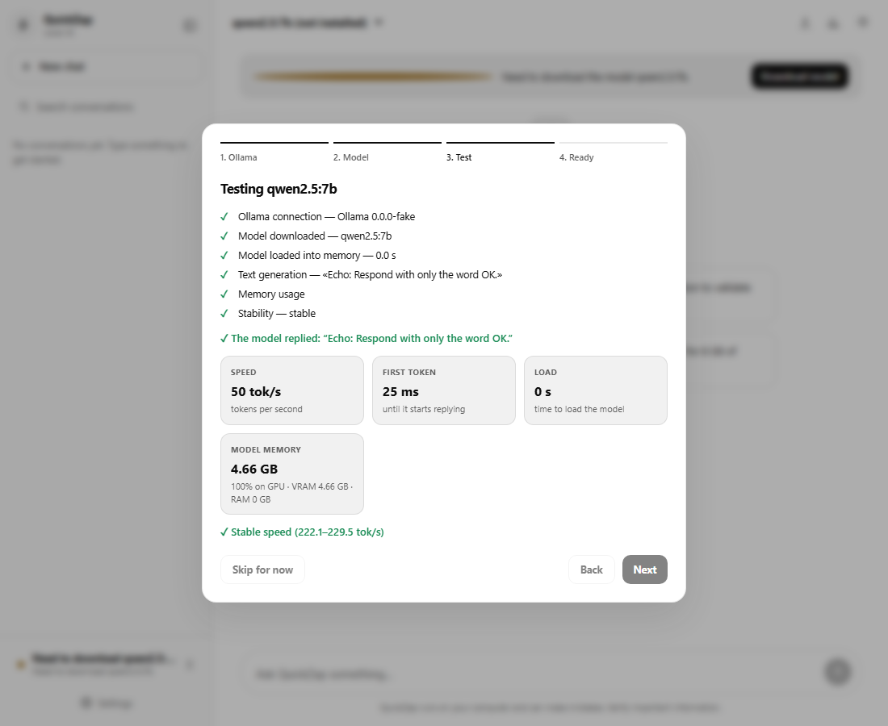

# Quickzap

> **QuickZap is a local-first AI chatbot powered by Ollama, featuring selective RAG, persistent memory, automatic hardware detection and offline support.**

*English summary:* Quickzap runs a language model on your own computer through [Ollama](https://ollama.com). It detects your
CPU, RAM and GPU, recommends a quantized model that fits, installs everything with a step-by-step wizard, benchmarks the model
(tokens/s, time to first token, memory, stability) and keeps your chats in a local SQLite file. The interface is in English.
Selective RAG is on the roadmap and **not implemented yet** — see [Status](#status).

## Status

Quickzap is under active development. Here is what **already works and is tested** and what does not exist yet:

| Area | Status |
|---|---|
| Local chat with Ollama (live responses), persistent history in SQLite, switching models without losing conversations | ✅ |
| Installation wizard: detects/installs/starts Ollama, chooses and downloads the model, progress bar, clear errors and retries | ✅ |
| Detection of CPU, RAM, GPU, and VRAM; model recommendation and quantization (Q4 / Q5 / Q8) that **does not exceed** your resources | ✅ |
| Benchmark: tokens/s, time to first token, loading, RAM/VRAM, stability; separate errors in installation / loading / generation | ✅ |
| Statistics dashboard and model comparison | ✅ |
| Hardware comparison tools (`bench`, `bench-compare`) and 8-question quality battery | ✅ (no published results yet) |
| **Selective RAG** (documents, embeddings, cited sources, cache) | 🚧 not implemented |
| Verified corrections, contradiction detection, personal memory, response rating | 🚧 not implemented |
| PDF/DOCX import and scheduled learning | 🚧 not implemented |

> The description above represents the project's goal. Until RAG arrives, Quickzap is a local chat with
> hardware detection, benchmarks, and conversation memory.

## Screenshots

> **Demo** screenshots: they use a sample machine and a simulated Ollama (which is why "Echo" responses and the
> "fake" version appear). The numbers are not real measurements. They are generated with `python -m tests.screenshots`.

| Choose model (based on your hardware) | Test report | Statistics |
|---|---|---|
|  |  |  |

## Quick Start

1. Install **Python 3.9 or higher** (on Windows, the launcher offers to install it if missing).
2. Download the project (**Code → Download ZIP**) and unzip it.
3. **Windows:** double-click `Iniciar-Quickzap.bat`. **Linux / macOS:** `./start.sh`.

Your browser opens with a 4-step wizard: **Ollama → Model → Test → Ready**. You can skip it and reopen it with the
**⇩** button. Leave the black window open while using Quickzap: it's the local server.

Prefer the console? `setup.ps1` (Windows) or `./setup.sh` (Linux/macOS) do the same without an interface.
Something failing? Check the [troubleshooting guide](docs/TROUBLESHOOTING.md).

## Requirements

**Mandatory:** Python 3.9+, [Ollama](https://ollama.com) (the wizard installs it on Windows and macOS via Homebrew; on Linux it shows the
official command) and disk space for the model (from under 1 GB up to ~9 GB depending on the model). There are no pip packages to install.

**Hardware recommendations:** we do not set arbitrary minimums, because they depend on the model. Quickzap calculates what fits in *your* machine
(see below) and the benchmark system is used to replace those estimates with real community data:
[docs/BENCHMARKS.md](docs/BENCHMARKS.md). The estimated memory of each model is in [docs/MODELS.md](docs/MODELS.md).

## How Quickzap Chooses the Model

It detects CPU, total and available RAM, and GPU/VRAM (NVIDIA with `nvidia-smi`; on Apple Silicon it estimates unified memory).
For each model and quantization, it estimates the required memory (weights + context cache + buffers) and classifies it:

| Classification | Meaning |
|---|---|
| **Fits in your GPU** | Fits entirely in free VRAM (~0.7 GB reserved for the desktop). This is the only thing recommended with a GPU. |
| GPU + RAM (slower) | Part of the layers goes to RAM. Offered, but not recommended. |
| CPU only (slow) | Fits in free RAM (~4 GB reserved for the system). Without a GPU, a model up to ~3.5B is recommended. |
| Exceeds resources | Shown as disabled. |

Quantizations: **Q4** (default, balanced), **Q5** (~15% more memory, slightly better quality), **Q8** (~75% more memory, almost no loss).
These rules are **heuristics**, not guarantees: if a recommended model runs slow or runs out of memory, [let us know](CONTRIBUTING.md#contributing-benchmarks).

## Commands

```bash
python -m quickzap                  # starts the app (http://localhost:8765)
python -m quickzap --port 8766      # alternative port
python -m quickzap hardware         # detected CPU, RAM, GPU and recommended model
python -m quickzap recommend        # recommendation only
python -m quickzap pull qwen2.5:3b  # downloads a model (with progress bar) and selects it
python -m quickzap doctor           # verifies Ollama, model, loading, generation, and GPU
python -m quickzap bench            # full benchmark; saves a report in benchmarks/
python -m quickzap bench --quick --quality   # without stability, with quality battery
python -m quickzap bench-compare "benchmarks/*.json"   # Markdown comparison table
python -m quickzap models --markdown                   # compatible models table
