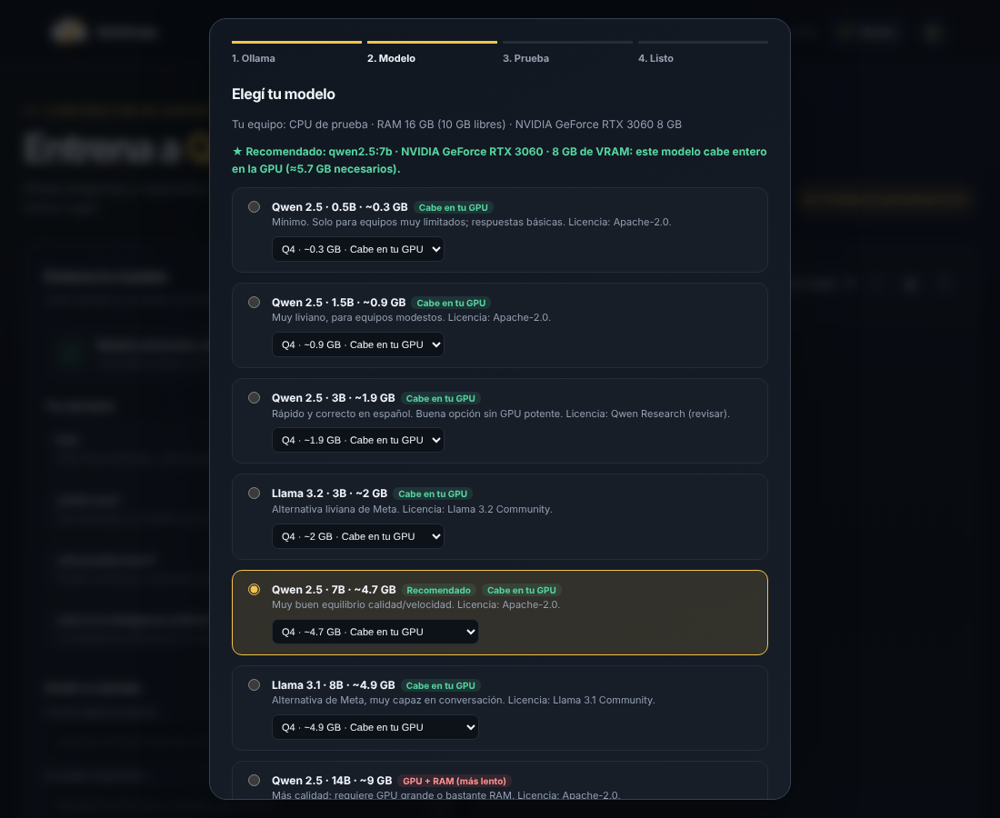
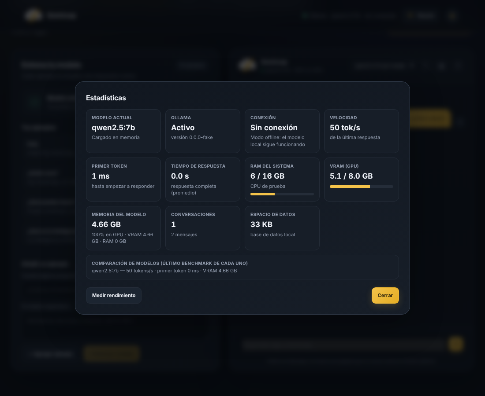

# Quickzap

> **QuickZap is a local-first AI chatbot powered by Ollama, featuring selective RAG, persistent memory, automatic hardware detection and offline support.**

*English summary:* Quickzap runs a language model on your own computer through [Ollama](https://ollama.com). It detects your
CPU, RAM and GPU, recommends a quantized model that fits, installs everything with a step-by-step wizard, benchmarks the model
(tokens/s, time to first token, memory, stability) and keeps your chats in a local SQLite file. The interface is in Spanish.
Selective RAG is on the roadmap and **not implemented yet** — see [Estado](#estado).

## Estado

Quickzap está en desarrollo activo. Esto es lo que **ya funciona y está probado** y lo que todavía no existe:

| Área | Estado |
|---|---|
| Chat local con Ollama (respuestas en vivo), historial persistente en SQLite, cambio de modelo sin perder conversaciones | ✅ |
| Asistente de instalación: detecta/instala/inicia Ollama, elige y descarga el modelo, barra de progreso, errores comprensibles y reintentos | ✅ |
| Detección de CPU, RAM, GPU y VRAM; recomendación de modelo y cuantización (Q4 / Q5 / Q8) que **no exceda** tus recursos | ✅ |
| Benchmark: tokens/s, tiempo hasta el primer token, carga, RAM/VRAM, estabilidad; errores separados en instalación / carga / generación | ✅ |
| Panel de estadísticas y comparación de modelos | ✅ |
| Herramientas para comparar equipos (`bench`, `bench-compare`) y batería de calidad de 8 preguntas | ✅ (aún sin resultados publicados) |
| **RAG selectivo** (documentos, embeddings, fuentes citadas, caché) | 🚧 no implementado |
| Correcciones verificadas, detección de contradicciones, memoria personal, calificación de respuestas | 🚧 no implementado |
| Importación de PDF/DOCX y aprendizaje programado | 🚧 no implementado |

> La descripción de arriba es el objetivo del proyecto. Hasta que llegue el RAG, Quickzap es un chat local con
> detección de hardware, benchmarks y memoria de conversaciones.

## Capturas

> Capturas de **demostración**: usan un equipo de ejemplo y un Ollama simulado (por eso aparecen respuestas «Eco» y la
> versión «fake»). Los números no son mediciones reales. Se generan con `python -m tests.screenshots`.

| Elegir modelo (según tu hardware) | Informe de la prueba | Estadísticas |
|---|---|---|
|  |  |  |

## Inicio rápido

1. Instalá **Python 3.9 o superior** (en Windows, el lanzador te ofrece instalarlo si falta).
2. Descargá el proyecto (**Code → Download ZIP**) y descomprimilo.
3. **Windows:** doble clic en `Iniciar-Quickzap.bat`. **Linux / macOS:** `./start.sh`.

Se abre el navegador con un asistente de 4 pasos: **Ollama → Modelo → Prueba → Listo**. Podés omitirlo y reabrirlo con el
botón **⇩**. Dejá abierta la ventana negra mientras uses Quickzap: es el servidor local.

¿Preferís la consola? `setup.ps1` (Windows) o `./setup.sh` (Linux/macOS) hacen lo mismo sin interfaz.
¿Algo falla? Mirá la [guía de solución de problemas](docs/TROUBLESHOOTING.md).

## Requisitos

**Obligatorios:** Python 3.9+, [Ollama](https://ollama.com) (el asistente lo instala en Windows y macOS con Homebrew; en Linux muestra el
comando oficial) y espacio en disco para el modelo (desde menos de 1 GB hasta unos 9 GB según el modelo). No hay paquetes de pip que instalar.

**Recomendaciones de hardware:** no fijamos mínimos arbitrarios, porque dependen del modelo. Quickzap calcula qué entra en *tu* equipo
(ver abajo) y el sistema de benchmarks sirve para reemplazar esas estimaciones por datos reales de la comunidad:
[docs/BENCHMARKS.md](docs/BENCHMARKS.md). La memoria estimada de cada modelo está en [docs/MODELS.md](docs/MODELS.md).

## Cómo elige Quickzap el modelo

Detecta CPU, RAM total y disponible, y GPU/VRAM (NVIDIA con `nvidia-smi`; en Apple Silicon estima la memoria unificada).
Para cada modelo y cuantización estima la memoria necesaria (pesos + caché de contexto + buffers) y lo clasifica:

| Clasificación | Significado |
|---|---|
| **Cabe en tu GPU** | Entra entero en la VRAM libre (se reservan ~0.7 GB para el escritorio). Es lo único que se recomienda con GPU. |
| GPU + RAM (más lento) | Parte de las capas va a la RAM. Se ofrece, pero no se recomienda. |
| Solo CPU (lento) | Entra en la RAM libre (se reservan ~4 GB para el sistema). Sin GPU se recomienda un modelo de hasta ~3.5B. |
| Excede los recursos | Se muestra deshabilitado. |

Cuantizaciones: **Q4** (por defecto, equilibrada), **Q5** (~15% más memoria, algo más de calidad), **Q8** (~75% más memoria, casi sin pérdida).
Estas reglas son **heurísticas**, no garantías: si un modelo recomendado te va lento o se queda sin memoria, [contanos](CONTRIBUTING.md#aportar-benchmarks).

## Comandos

```bash
python -m quickzap                  # inicia la app (http://localhost:8765)
python -m quickzap --port 8766      # otro puerto
python -m quickzap hardware         # CPU, RAM, GPU detectadas y modelo recomendado
python -m quickzap recommend        # solo la recomendación
python -m quickzap pull qwen2.5:3b  # descarga un modelo (con barra de progreso) y lo selecciona
python -m quickzap doctor           # verifica Ollama, modelo, carga, generación y GPU
python -m quickzap bench            # benchmark completo; guarda un informe en benchmarks/
python -m quickzap bench --quick --quality   # sin estabilidad, con batería de calidad
python -m quickzap bench-compare "benchmarks/*.json"   # tabla comparativa en Markdown
python -m quickzap models --markdown                   # tabla de modelos compatibles
```

## Benchmark y diagnóstico

El paso 3 del asistente y `python -m quickzap bench` miden, en este orden: conexión con Ollama → modelo descargado → **carga** en memoria
(en frío) → **generación real de texto** (con el mensaje «El modelo respondió: …») → uso de memoria (modelo en GPU/RAM, RAM y VRAM del
sistema) → **estabilidad** en una generación larga (opcional). Si algo falla, el error se clasifica en **instalación**, **descarga**,
**carga del modelo** o **generación**, con una sugerencia de qué hacer.

## Estadísticas

El botón **▦** del chat muestra: modelo actual, estado de Ollama, con/sin Internet, tokens por segundo, tiempo hasta el primer token,
tiempo de respuesta, RAM y VRAM, memoria del modelo, conversaciones, espacio de datos y la comparación de modelos medidos.

## Arquitectura

```
web/index.html         Interfaz (una sola página, sin build, sin recursos externos)
quickzap/server.py     Servidor HTTP local + API (/api/chat, /api/stats, /api/benchmark, /api/setup/*, …)
quickzap/ollama.py     Cliente de la API de Ollama (streaming, carga/descarga de modelos, progreso de descarga)
quickzap/hardware.py   Detección de CPU/RAM/GPU y ajuste de modelos a recursos
quickzap/benchmark.py  Benchmark por fases; evals.py: batería de calidad; diagnostics.py: errores comprensibles
quickzap/installer.py  Detecta, instala e inicia Ollama (solo comandos fijos)
quickzap/db.py         SQLite: conversaciones, mensajes, ajustes, métricas, benchmarks
quickzap/reports.py    Informes y tablas comparativas
scripts/               check_secrets.py (revisión previa a publicar)
tests/                 Pruebas con un Ollama simulado (sin GPU ni descargas) y pruebas de navegador opcionales
```

## Privacidad y seguridad

- Todo corre en tu equipo. Las conversaciones se guardan en `data/quickzap.db` (ignorado por git). Nada se envía a servidores de Quickzap.
- Solo hay tráfico de red para: descargar Ollama y modelos, comprobar si hay Internet (una conexión TCP a `1.1.1.1:53`, sin enviar datos)
  y, **solo si Ollama no está disponible**, el modo anterior de búsqueda pública (Wikipedia, Wikidata, OpenAlex).
- El servidor escucha solo en `127.0.0.1` y rechaza peticiones con `Host`/`Origin` ajenos. El asistente ejecuta únicamente comandos fijos.
- Los informes de benchmark no incluyen nombre de usuario ni de equipo. `python scripts/check_secrets.py` revisa el repositorio antes de publicar.

## Documentación

[Modelos compatibles](docs/MODELS.md) · [Benchmarks](docs/BENCHMARKS.md) · [Solución de problemas](docs/TROUBLESHOOTING.md) ·
[Contribuir](CONTRIBUTING.md) · [Cambios](CHANGELOG.md) · [Licencias de terceros](THIRD_PARTY.md)

## Hoja de ruta

1. ✅ Motor local, chats persistentes, asistente, hardware, benchmark y estadísticas.
2. RAG selectivo: documentos, chunking, embeddings, búsqueda semántica, duplicados, fuentes citadas, caché y límites de almacenamiento.
3. Correcciones verificadas, detección de contradicciones, memoria personal, calificación de respuestas.
4. Aprendizaje bajo demanda y programado, importación de PDF/DOCX.

## Pruebas

```bash
python -m unittest discover -s tests -t . -v     # sin dependencias
python -m tests.e2e_wizard                       # opcional: navegador real (requiere playwright)
python scripts/check_secrets.py                  # revisión de secretos y datos personales
```

## Licencia

[MIT](LICENSE). Los modelos que descargues tienen sus propias licencias: ver [THIRD_PARTY.md](THIRD_PARTY.md).
